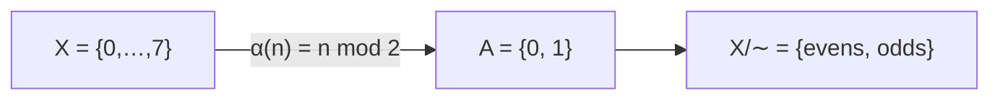

This page is an executable style sheet: everything below is rendered from plain Markdown in `content/about/authoring.md`, written in an ordinary text editor. #meta #mathematics/algebra

## Links

Wiki links resolve by file name anywhere in `content/`: [[abstraction]], [[heidegger]], and [[ready-to-hand]]. Display text goes after a bar: [[abstraction-leak|leaky abstractions]]. A page can also be reached through one of its `aliases`, as in [[Leaky abstraction]]. Ordinary Markdown links work too: [the Simondon essay](../blurbs/simondon.md). Every page lists the pages that link to it under *Backlinks*.

## Tags

Tags can be listed in the frontmatter or written inline, like #representation or the nested #mathematics/algebra. Both forms produce the same tag, and writing #representation again does not add it twice. A tag needs a space (or the start of a line) before the `#`, so (#this) is not a tag. A `#` inside `code`, in a URL such as https://example.com/page#section, or in math like $|A| = \#A$ is not a tag either.

## Mathematics

Inline math sits in the text: an abstraction $\alpha : X \to A$ induces the relation $x \sim y \iff \alpha(x) = \alpha(y)$, and the quotient $X/{\sim}$ has $\lvert A \rvert$ classes when $\alpha$ is onto.

Display math gets its own line:

$$
\forall x \in X \;\; \exists!\, [x] \in X/{\sim} : \quad x \in [x], \qquad \frac{|X|}{|X/{\sim}|} = 4 \text{ for parity on } \{0,\dots,7\}.
$$

$$
\begin{aligned}
\alpha_{2}(n) &= n \bmod 2, \\
\alpha_{3}(n) &= n \bmod 3, \\
\alpha_{<}(n) &= \begin{cases} 0 & n < 4 \\ 1 & n \ge 4 \end{cases}
\end{aligned}
\qquad
P = \begin{pmatrix} 1 & 0 & 1 & 0 \\ 0 & 1 & 0 & 1 \end{pmatrix}
$$

## Citations and footnotes

Citations use keys from `bibliography.bib`: information theory set meaning aside from the start [@shannon1948mathematical, p. 379], a move with older roots [@turing1936computable; @whitehead1911introduction]. Narrative form works as well: @abelson1996structure open with Locke. The formatted references appear at the end of the page.

Footnotes stay separate from citations and hold commentary.[^aside]

[^aside]: A footnote is for remarks; a citation is for sources.

## Diagrams



## Code

```python
def alpha(n: int) -> int:  # parity abstraction; this '#' is a comment, not a tag
    return n % 2
```
